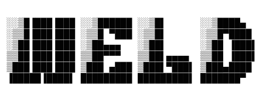

<p align="center">
  
</p>

<h1 align="center">Weld</h1>

<p align="center">
  <a href="https://github.com/podomy/weld/actions/workflows/ci.yml"></a>
  <a href="LICENSE"></a>
</p>

Weld is robotics middleware written in Go. One unified core moves topics, services, actions, and parameters across transports, with structured delivery, copy once handling, and a leaderless data plane that stays correct under partition. Version one ships the DDS backend against CycloneDDS; FastDDS, Zenoh, and MQTT transports follow after v1 behind the same interface.

Weld speaks ROS 2 on the wire, so Go programs join ROS 2 systems as first-class nodes, verified by mixed fleet behavior.

### Documentation

- [Weld design](./docs/design.md): architecture, invariants, and build order.
- [Weld invariants](./docs/invariants.md): 250+ testable promises the system holds, drawn from 6000+ upstream ROS issues.
- [Overview](./docs/overview.md): what Weld is and what v1 ships.
- [Types](./docs/types.md): IDL mapping, registry, constants.
- [Type hashes](./docs/hash.md): RIHS01 computation and negotiation.
- [CDR](./docs/cdr.md): XCDR1 wire encoding.
- [Introspection and bounds](./docs/introspection.md): reflection tables and limits.
- [Corpus](./docs/corpus.md): message families and fixtures.
- [QoS](./docs/qos.md): matching, best-available, facade, retention.
- [Transports](./docs/transports.md): backend interface and DDS sidecar.
- [Interop](./docs/interop.md): field notes from CycloneDDS interop.
- [Testbed](./docs/testbed.md): Docker peers and first interop.
- [Conformance](./docs/conformance.md): wire end state and gate record.
- [Wireless](./docs/wireless.md): Rappaport distilled for WiFi fleets.
- [CLI](./docs/cli.md): the weld echo/pub commands plus `weld action send`.
- [Glossary](./docs/glossary.md): terms in plain words.
- [FAQ](./docs/faq.md): constants, identity quaternion, one binary, sidecar.

### Scope

Proven by live gates against CycloneDDS on Humble, Jazzy, and Rolling, both directions: the topic-level wire (discovery, XCDR1 bytes for the full standard message set, QoS matching, large fragmented payloads), services as calls (Weld client against ROS Trigger server, ROS client against Weld Trigger server, deadline expiry), parameters as reads plus atomic sets plus validation rejections against real ROS parameter servers, actions as goal workflows (accept, cancel, timeout), and TF transforms as versioned store plus lookup (latched statics, timed dynamics, unknown-frame errors). An ROS 2 node cannot distinguish Weld from a native peer on these paths. Details in [Conformance](./docs/conformance.md) and [Interop](./docs/interop.md).

Implemented with unit tests plus exchange-format coverage but without mixed-fleet proofs yet: bag exchange formats (`internal/bags`), the Go SDK surface (`sdk/`, in-memory plus fake-clock tests), launch argument acceptance (`weld launch`), and the actions CLI verb (`weld action send` exists; the live gate drives the backend directly).

Deliberately not ported and never to be: `rcl` wait sets, executors with callback groups, `rmw` handles.

Known honest gaps, each with reason: `std_msgs/msg/ByteMultiArray` forward publish uses per-element `!!binary` YAML because the plain integer list crashes `ros2 topic pub` in `rclpy` C code (toolchain quirk only, byte-identical on the wire, fully passing, not a skip); `trajectory_msgs/msg/JointTrajectoryControllerState` has no gate because the type does not exist in the installed distros (absent type, clean skip). The former forward-echo user-DATA gap is closed: it was three stacked causes, not fleet churn. First, our readers announced transient-local while `ros2 topic pub` offers volatile, so RxO never matched and no DATA flowed; readers now announce volatile like `ros2 topic echo`. Second, SPDP announced participant-zero unicast ports while the socket bound a later slot, diverting a second participant's unicast to the first; SPDP now announces the bound ports. Third, SO_REUSEPORT load-balanced multicast across same-host sockets so one participant starved, and user DATA multicast was never joined at all; REUSEPORT is off and the user-traffic group is joined with fanout. All forward-echo tests pass with no skips.

### Testbed

Reproducible ROS peers for the conformance gates: one container per supported distro (`weld-humble`, `weld-jazzy`, `weld-rolling`), each able to speak every RMW Weld must interoperate with. Full detail is in [Testbed](./docs/testbed.md); wire end state and gate record are in [Conformance](./docs/conformance.md).

Requirements: Docker, about 8 GB free for images.

```bash
cd testbed
docker compose build
docker compose up -d
docker compose ps
```

Each container idles on `sleep infinity` with host networking, so DDS multicast discovery works without extra configuration. Give each test run its own domain id to keep runs isolated. All live checks are Go only with docker argv and no shell; `ros2` runs directly via `-e` flags (see `testbed/live/helpers/helpers.go:109-122`).

Teardown:

```bash
docker compose down
```

Offline Go checks and the live round trip:

```bash
go test ./testbed/unit/... -count=1
go test -tags live ./testbed/live/... -count=1
```

Layout is `testbed/unit/*` for pure Go, `testbed/live/*` for Docker checks, `testbed/logs/` for peer logs. Unit files use conformance_test.go files; live files use gate star test files plus roundtrip files with no generic live_test.go file and no empty files. Test names keep the Cyclone versus ROS split obvious: Cyclone SPDP checks use `TestCyclone` and ROS String checks use `TestROS`; single entrypoint gates use `TestGate`. The unit run needs no container. The live run uses domain 47 on the
already running `weld-jazzy` container (bring the fleet up once with
`docker compose up -d` above, never per run); it skips when Docker or the container is
absent. Domain split is 42 for ROS String (`testbed/live/ros/roundtrip_test.go:24`), 48 for SPDP (`testbed/live/cyclone/gate1_spdp_test.go:20`), 47 for the single entrypoint live gate (`testbed/live/helpers/helpers.go:40`), 43 plus 44 for the Humble plus Rolling distro matrix (`testbed/live/helpers/distro.go:46-50`, `testbed/live/helpers/distro.go:54-58`), 55 for large payloads (46 abandoned, no host-container multicast), and 60 through 69 for ephemeral isolation (`testbed/live/helpers/helpers.go:49-52`). Only one run at a time per domain
and topic, each with a per-run live ID (`testbed/live/helpers/helpers.go:130`). Restart a stale fleet with `cd testbed && docker compose down && docker compose up -d`. Full detail is in [Testbed](./docs/testbed.md) and [Testbed README](./testbed/README.md); wire end
state and gate record are in [Conformance](./docs/conformance.md).

Removing images as well (`docker compose down --rmi all`) frees the 8 GB. The Dockerfiles pin nothing beyond the ROS apt snapshots, so rebuild monthly to stay current with the distros.

### Contributing

Discuss your change with the engineering team at [contact@podomy.com](mailto:contact@podomy.com) before opening a PR in order not to waste anybody's effort or time.

Announcements and engineering updates on distributed systems, consensus algorithms, and robotic fleet coordination are shared via our newsletter at [podomy.com](https://podomy.com).

- [Commit message format](./COMMITS)
- [Contributor license agreement](./CLA)
- [Contributing](./CONTRIBUTING)

### License

Weld is distributed under the GNU Affero General Public License v3.0 or
later. See [LICENSE](./LICENSE).
