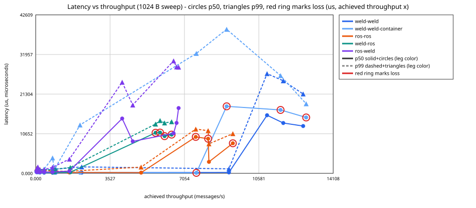

<h1 align="center">Weld</h1>

  

Up to 68% lower latency than ROS 2 on the same host, with zero loss where ROS drops.

Weld is Go robotics middleware, wire-compatible with ROS 2, for fleets that must coordinate where links die. One leaderless data plane carries topics, services, actions, and parameters; version one ships the CycloneDDS backend.

Proven by a 110-row benchmark matrix, green end to end: lower p50 latency at every payload size, zero loss to 100 kHz where ROS first drops at 10 kHz.

  

Full docs live in [docs/](/docs).

## Commercial Licensing

Commercial licenses are available. Contact [contact@podomy.com](mailto:contact@podomy.com).

## Contributing

Weld takes no pull requests or GitHub Issues. Propose first, patch second, both by email to [contact@podomy.com](mailto:contact@podomy.com): an RFC describing the problem, then a `git format-patch` series.

## License

GNU Affero General Public License v3.0 or later. See [LICENSE](/LICENSE). Questions: [contact@podomy.com](mailto:contact@podomy.com).
