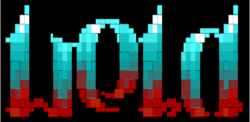

  

  
  

Weld is robotics middleware written in Go. One unified core moves topics, services, actions, and parameters across transports, with structured delivery, copy once handling, and a leaderless data plane that stays correct under partition. Version one ships the DDS backend against CycloneDDS; FastDDS, Zenoh, and MQTT transports follow after v1 behind the same interface.

Weld speaks ROS 2 on the wire, so Go programs join ROS 2 systems as first-class nodes, verified by mixed fleet behavior.

### Documentation

- [Weld design](./docs/design.md): architecture, invariants, and build order.
- [Weld invariants](./docs/invariants.md): 250+ testable promises the system holds, drawn from 6000+ upstream ROS issues.
- [Overview](./docs/overview.md): what Weld is and what v1 ships.
- [Types](./docs/types.md): IDL mapping, registry, constants.
- [Type hashes](./docs/hash.md): RIHS01 computation and negotiation.
- [CDR](./docs/cdr.md): XCDR1 wire encoding.
- [Introspection and bounds](./docs/introspection.md): reflection tables and limits.
- [Corpus](./docs/corpus.md): message families and fixtures.
- [QoS](./docs/qos.md): matching, best-available, facade, retention.
- [Transports](./docs/transports.md): backend interface and DDS sidecar.
- [Interop](./docs/interop.md): field notes from CycloneDDS interop.
- [Testbed](./docs/testbed.md): Docker peers and first interop.
- [Conformance](./docs/conformance.md): wire end state and gate record.
- [Wireless](./docs/wireless.md): Rappaport distilled for WiFi fleets.
- [CLI](./docs/cli.md): the weld echo/pub commands plus `weld action send`.
- [Glossary](./docs/glossary.md): terms in plain words.
- [FAQ](./docs/faq.md): constants, identity quaternion, one binary, sidecar.

### Contributing

Discuss your change with the engineering team at [contact@podomy.com](mailto:contact@podomy.com) before opening a PR in order not to waste anybody's effort or time.

Announcements and engineering updates on distributed systems, consensus algorithms, and robotic fleet coordination are shared via our newsletter at [podomy.com](https://podomy.com).

- [Commit message format](./COMMITS)
- [Contributor license agreement](./CLA)
- [Contributing](./CONTRIBUTING)

### License

Weld is distributed under the GNU Affero General Public License v3.0 or
later. See [LICENSE](./LICENSE).
